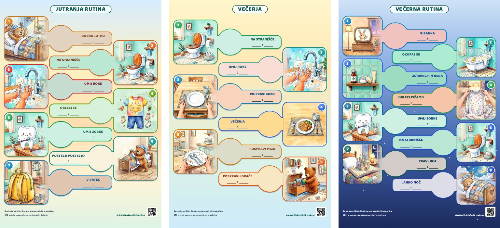

# Child routines

**English** · [Slovenščina](README.sl.md)

**[Open the sheet maker →](https://stutek.github.io/child-routines/)**

Printable A4 sheets with a daily routine for children aged 3 and up: morning, dinner and evening. Your child follows the pictures and marks each finished step with a magnet or a tick. Adults read the order and the time.



Free, no sign-up and no ads. What you type stays in your browser.

## How to make your sheet

1. Open the [sheet maker](https://stutek.github.io/child-routines/), easiest on a computer. It starts with an example evening routine.
2. Pick the routine type and type the steps (up to 8). You can change the title and labels, swap a picture by clicking it, and reorder by dragging the dots. Type a time or hide it (*Time on the sheet*).
3. Click **Print**: A4, margins *None*, scale 100%. For a grandparent or a print shop, choose *Save as PDF*. You can put the sheet on the fridge or a board.

## How to use it

- **Make the sheet together with your child**, and do the steps together for the first few days. Your child picks the pictures, you set the order.
- **Start with one routine**, for a three-year-old with 3–4 steps.
- **A magnet means "done".** As a reward it can take the joy away.
- **The time is for adults.** A skipped step is no drama.
- **When your child sleeps over at relatives',** send the sheet along.

Example sheets, ready to print, are [here](https://stutek.github.io/child-routines/output/en-example.html).

## Safety

- **Age:** 3 and up.
- **Magnets:** a child must not swallow a magnet or a piece of one. Mind younger siblings. If it happens, see a doctor at once.
- **Medicine:** an adult gives and keeps it; it is not a sweet.
- **Bath:** never leave a child alone in the bath.

## Did it help?

Click **⭐ Star** on the [project page](https://github.com/stutek/child-routines) (needs a GitHub account) or share the link with other parents.

## For advanced users

### Print without a connection

1. On the [project page](https://github.com/stutek/child-routines) click **Code**, then **Download ZIP**, and unpack it. The sheets need the `images/` folder next to `output/`, so opening a single file on GitHub does not work.
2. In Chrome, open `web/index.html` for your own sheet or `output/en-example.html` for the example.
3. Print as above.

### Your own routine from files

Routines are data files in [`routines/<lang>/`](routines/). Copy one, change the labels, pictures and colors, then rebuild:

```bash
pip install -r requirements.txt
python3 tools/check_images.py   # checks images and routines
python3 tools/build.py          # writes output/<lang>-<name>.html
```

Images are in [`images/`](images/), each with its own metadata file. How to make new ones: [docs/PROMPTS.md](docs/PROMPTS.md).

### Your own routine with an agent

An AI coding agent (Claude Code, Codex, Gemini CLI or Antigravity) can build the routine for you. It loads the repository's instructions in [AGENTS.md](AGENTS.md) by itself.

1. Get the repository onto your computer (`git clone https://github.com/stutek/child-routines.git` or the ZIP above) and start the agent in its folder.
2. Describe the routine in your own words, for example:

   ```text
   In routines/en/ours.json, make a routine for my four-year-old: morning (wake up, toilet, wash hands, teeth, get dressed, preschool) and evening (bath, pajamas, teeth, story, sleep). Use the existing pictures where they fit, rebuild, and print it to PDF for me to check.
   ```

3. Check the result yourself in Chrome's print preview: every label is whole, the order is right, every picture matches its step.

Tips:

- **Personal details stay at home.** Your child's name on your own sheet is fine on your computer; do not commit it to a public fork or a pull request.
- **Use the existing pictures first.** Many coding agents cannot make images; new ones need an image model (the ones here were made with Google Gemini through Antigravity), following [docs/PROMPTS.md](docs/PROMPTS.md) and the [copyright check](.agents/skills/copyright-check/SKILL.md). Look at every new picture yourself before you print or share it.
- **Do not let the agent publish.** Review the changes before you push or open a pull request.

### Contributing

Parents can add routines, translations and pictures: see [CONTRIBUTING.md](CONTRIBUTING.md). Every new picture must pass the automatic copyright gate before it is merged.

## License

All content (code, pictures, routine texts, documentation) is dedicated to the public domain under [CC0 1.0](LICENSE): you may copy, change and use it for any purpose, without asking and without credit. The pictures were made with an image model; such pictures are most likely not protected by copyright, and CC0 says so plainly. CC0 does not cover any rights third parties may have.

For agents: [AGENTS.md](AGENTS.md).
