# Images

Generated by `tools/build.py` from `images/<id>.json`; do not edit by hand. To add an image, see [CONTRIBUTING.md](../CONTRIBUTING.md#add-an-image).

| Teddy bear | No character | Id | Title | Keywords | Used in |
| --- | --- | --- | --- | --- | --- |
| — |  | `bath` | Bubble bath ready with a rubber duck and a towel in the same bathroom | sl: kopanj*, kopel*, kopaj*, kad, tus*, okopaj* en: bath*, shower | en-example: EVENING ROUTINE 2 sl-primer: VEČERNA RUTINA 2 |
| 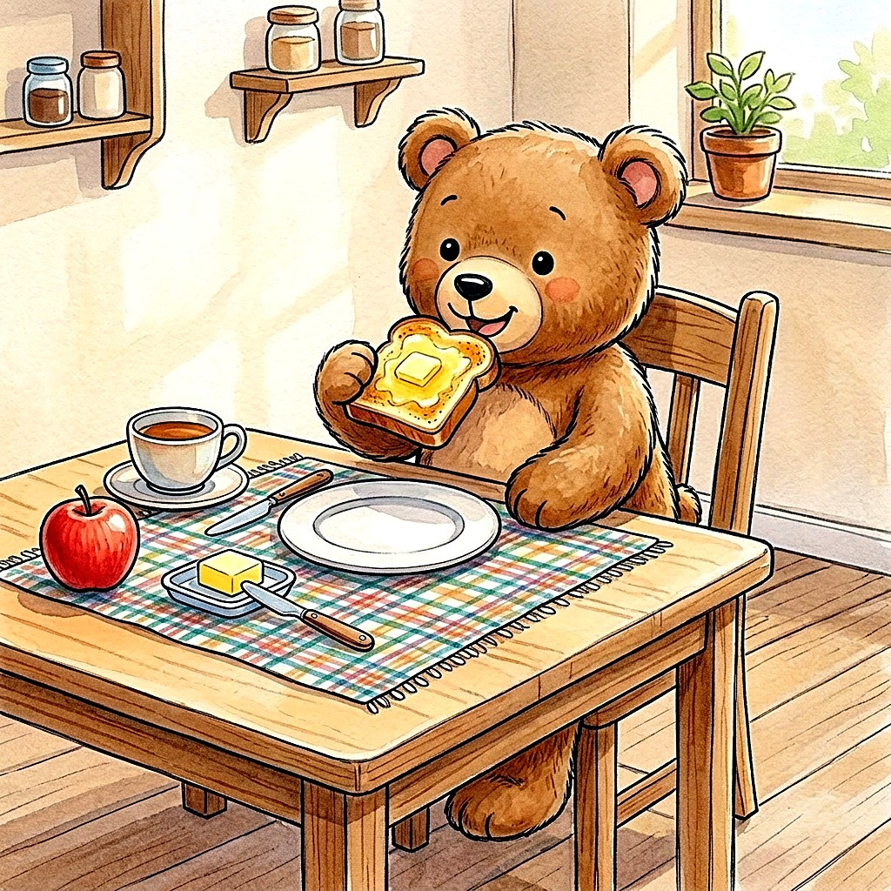 |  | `breakfast-bear` `breakfast` | Toast with butter, an apple and a cup of tea on the kitchen table | sl: zajtrk*, opecen*, toast, kruh*, jabolk*, caj, malic* en: breakfast, toast, bread, apple, tea, snack | en-example: MORNING ROUTINE 6 |
| 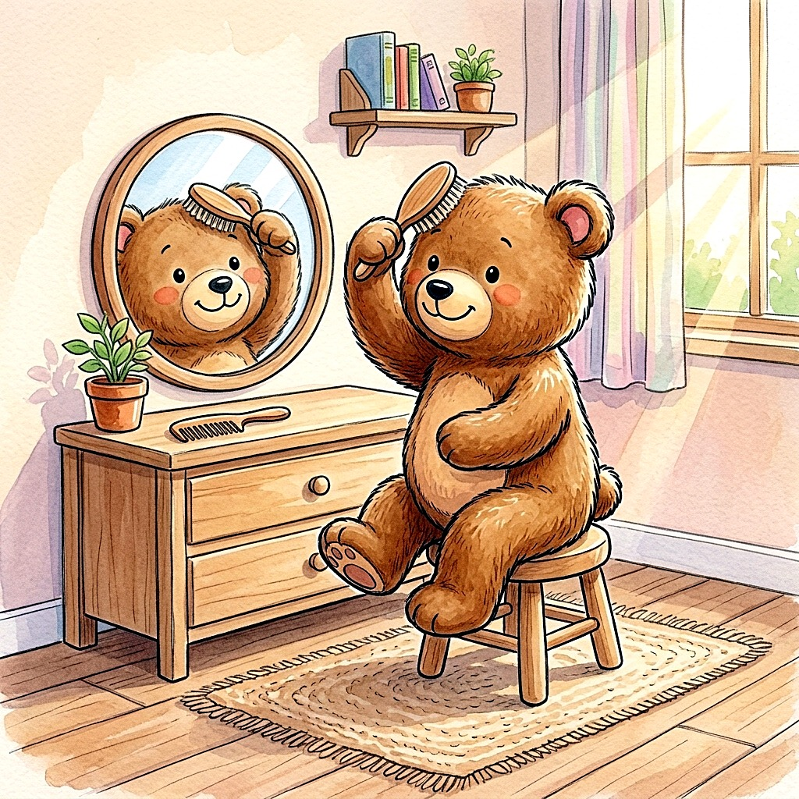 | 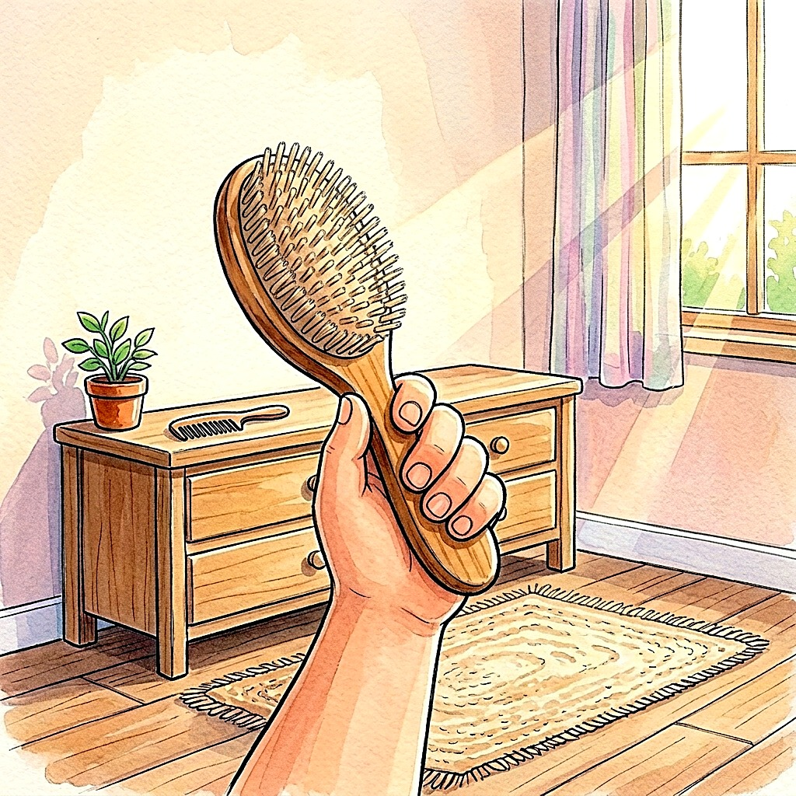 | `brush-hair` `brush-hair-plain` | Teddy bear on a stool brushing the fur on its head with a wooden brush, in front of a round mirror | sl: poces*, cesanj*, cesi se, lase, lasje, glavnik* en: brush hair, brush your hair, comb*, hair* | — |
|  | 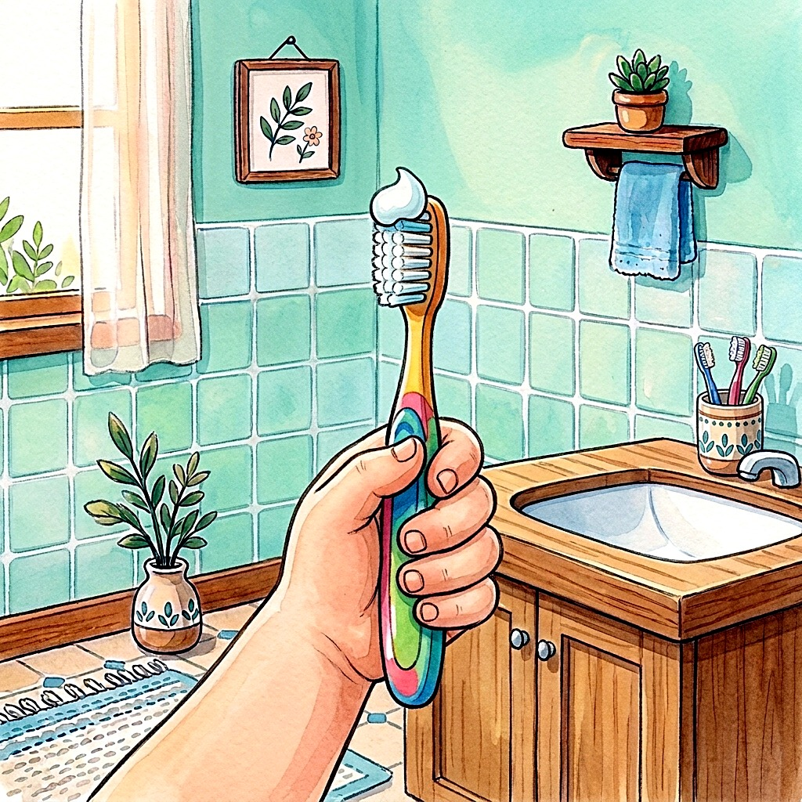 | `brush-teeth` `brush-teeth-plain` | Teddy bear behind the bathroom sink, seen from the front, brushing its teeth | sl: zob*, scetk*, krtack* en: teeth, tooth*, brush teeth, brush your teeth | en-example: MORNING ROUTINE 7 en-example: EVENING ROUTINE 5 sl-primer: JUTRANJA RUTINA 6 sl-primer: VEČERNA RUTINA 5 |
| — |  | `care` | Medicine bottle with a green cross, cream jar and tube evenly arranged on a bathroom shelf | sl: zdravil*, sirup*, vitamin*, kapljic*, krem*, mazil*, nega, negovaln*, namaz*, maz* en: medicine*, medication, syrup, vitamin*, drops, cream*, lotion, ointment, skin care | en-example: EVENING ROUTINE 3 sl-primer: VEČERNA RUTINA 3 |
| — |  | `cartoon` | Wooden TV showing hills, a river and a sailboat, with lamp, flowering plant and window | sl: risank*, tv, televizij*, ekran*, film* en: cartoon*, tv, television, screen time, show | en-example: EVENING ROUTINE 1 sl-primer: VEČERNA RUTINA 1 |
| — |  | `clear-table` | Child's hands carrying a used plate from the table | sl: pospravi mizo, pospravljanje mize, odnesi krozni* en: clear the table, clear table, clear up the table | en-example: DINNER 5 sl-primer: VEČERJA 5 |
| — |  | `dinner` | Plate of pasta, meatballs, carrots and broccoli on the set-table placemat | sl: vecerj*, jej, jemo, jest, obed*, kosil*, hrana en: dinner, eat*, meal, supper, lunch | en-example: DINNER 4 sl-primer: VEČERJA 4 |
| — |  | `getting-dressed` | Rainbow T-shirt, jeans and a pair of striped socks laid out on a child's bed | sl: oblac*, obleci, obleka, oblec* en: get dressed, getting dressed, dress*, clothes | en-example: MORNING ROUTINE 5 sl-primer: JUTRANJA RUTINA 5 |
|  | 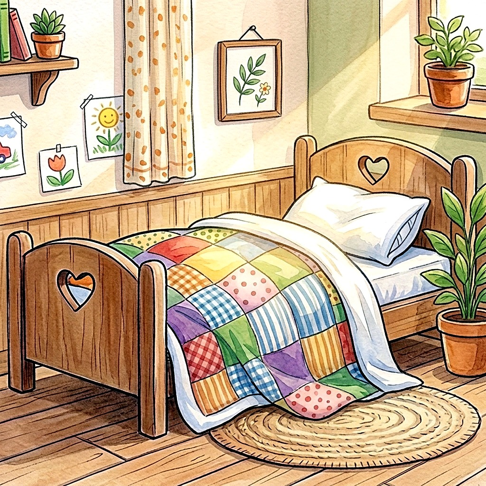 | `good-morning` `good-morning-plain` | Teddy bear in a striped nightcap sitting up in its wooden bed and stretching both paws up in the morning | sl: dobro jutro, jutro, bujenje, zbujanje, zbudi*, vstajanje, vstani, prebuj* en: good morning, wake up, waking up, get up, morning | en-example: MORNING ROUTINE 1 sl-primer: JUTRANJA RUTINA 1 |
| 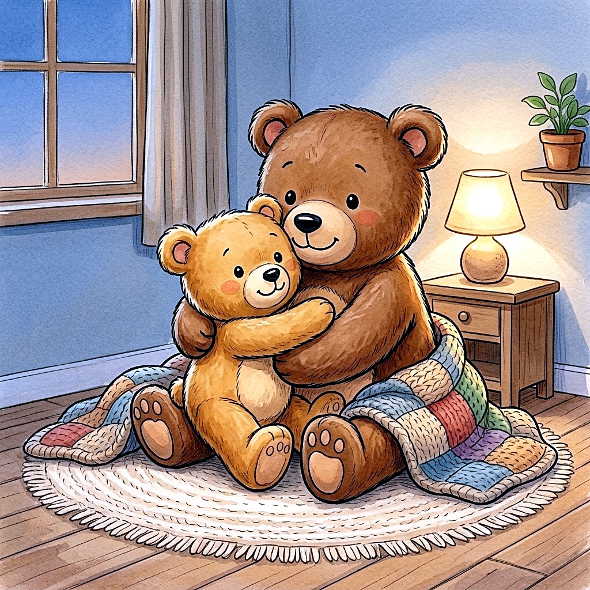 | 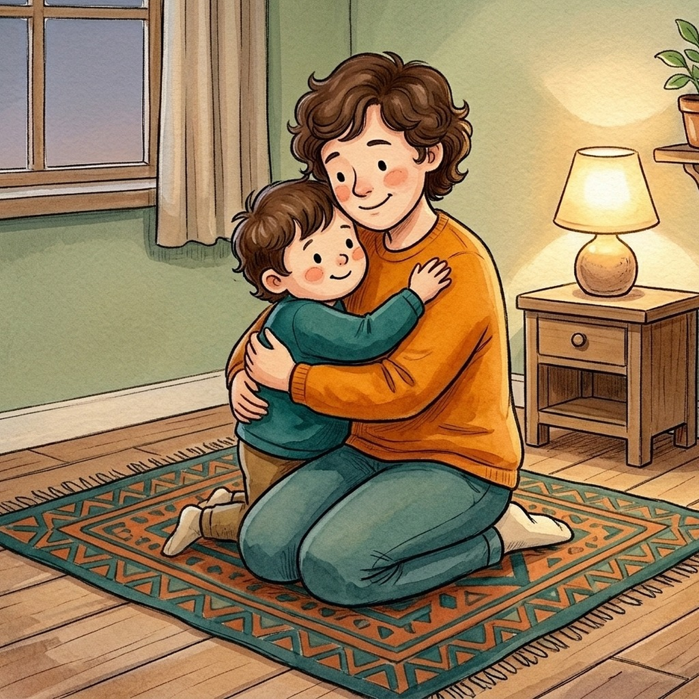 | `hug` `hug-plain` | Big brown and small honey-colored teddy bear hugging on a rug beside a glowing lamp in the evening | sl: objem*, objam*, crklj* en: hug*, cuddle* | — |
| — |  | `kindergarten` | Yellow backpack with straps and sneakers by the door | sl: vrtec, vrtc*, sola, solo, v solo, odhod, gremo ven en: kindergarten, preschool, nursery, daycare, school, leave | en-example: MORNING ROUTINE 8 sl-primer: JUTRANJA RUTINA 7 |
|  | 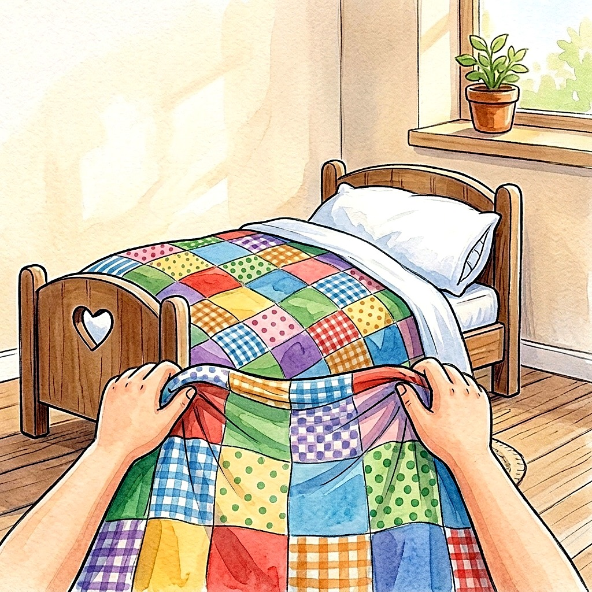 | `make-bed` `make-bed-plain` | Teddy bear standing beside its bed, raising the quilt to make the bed | sl: postelj*, postilj*, postlj* en: make the bed, make bed, make your bed, making the bed | en-example: MORNING ROUTINE 2 sl-primer: JUTRANJA RUTINA 2 |
| — |  | `pajamas` | Child's hands holding up a soft pajama top with moons and stars, pants on the bed | sl: pizam*, obleci pizamo, spalna srajc*, oblecem pizamo en: pajama*, pyjama*, pjs, nightwear | en-example: EVENING ROUTINE 4 sl-primer: VEČERNA RUTINA 4 |
| 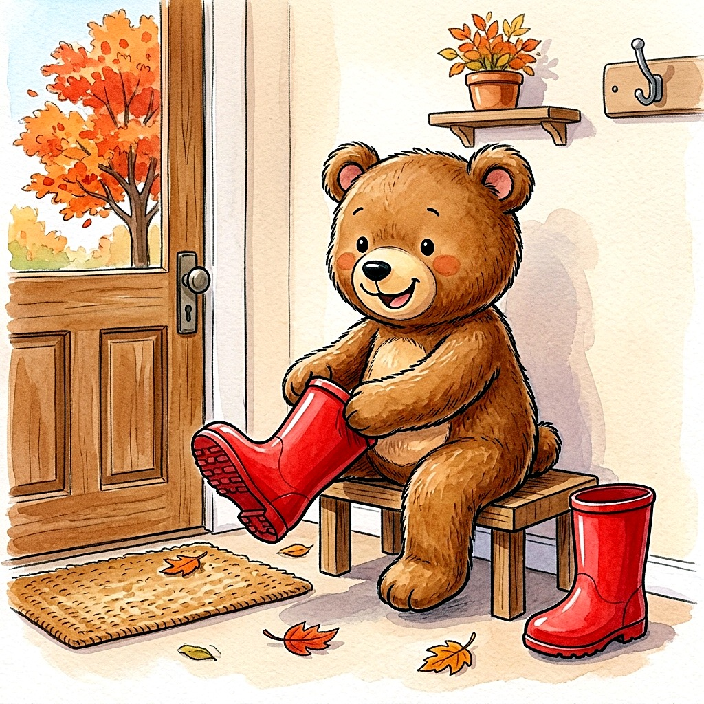 | 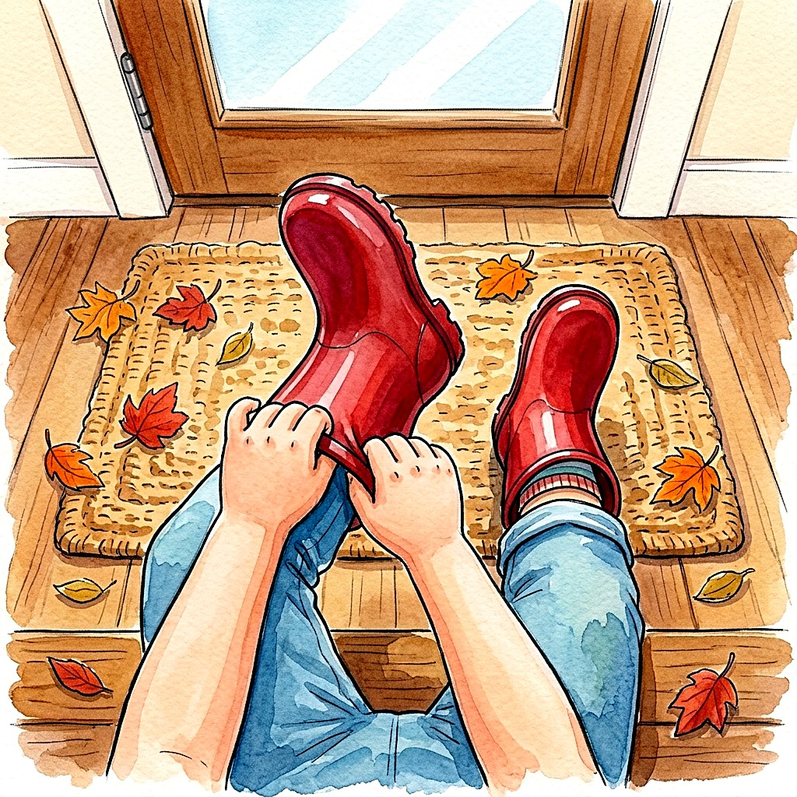 | `put-on-shoes` `put-on-shoes-plain` | Teddy bear on a bench in an autumn hall, pulling on a red rain boot, the other boot on the floor | sl: obuj*, obuv*, cevlj*, skorenj*, skornj* en: put on shoes, put on your shoes, shoes, shoe*, boots | — |
| — |  | `set-table` | Child's hands setting cutlery next to an empty plate | sl: pripravi mizo, priprava mize, pogrn*, pogrinj* en: set the table, lay the table, set table | en-example: DINNER 3 sl-primer: VEČERJA 3 |
|  | 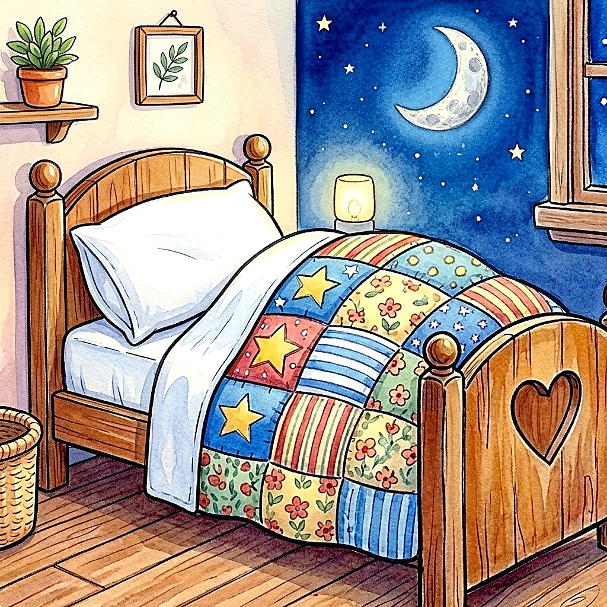 | `sleep` `sleep-plain` | Teddy bear lying asleep in bed under a night sky | sl: spanj*, spat*, spi, zaspi*, lahko noc, v posteljo, pocitek en: sleep*, go to bed, good night, lights out, nap | en-example: EVENING ROUTINE 8 sl-primer: VEČERNA RUTINA 8 |
| — |  | `story` | Open storybook on a bed with a pop-up castle | sl: pravljic*, zgodb*, knjig*, beri*, branje, prebere* en: story, stories, book*, read* | en-example: EVENING ROUTINE 7 sl-primer: VEČERNA RUTINA 7 |
|  | 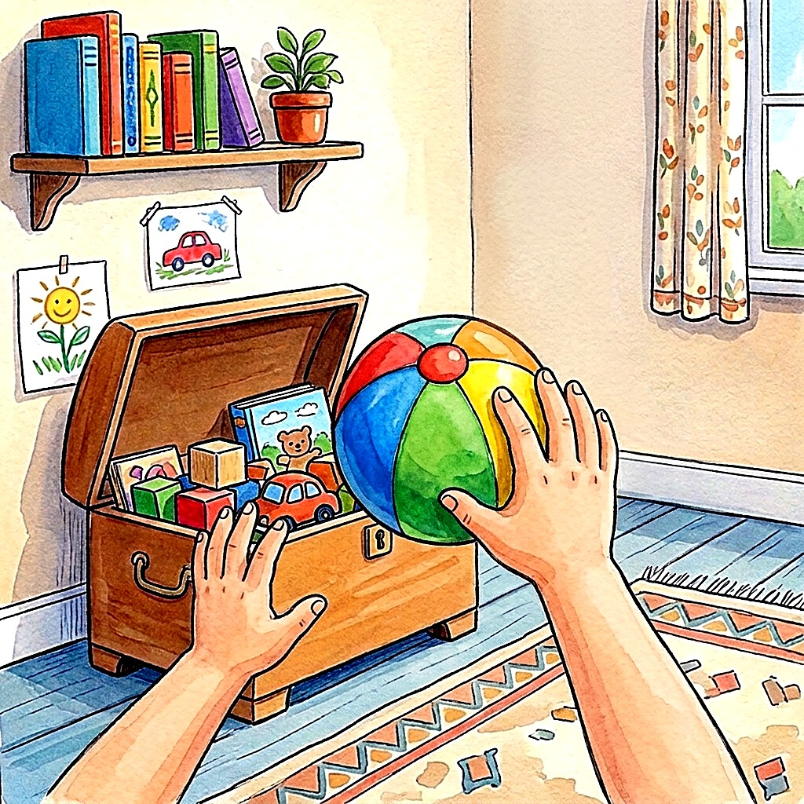 | `tidy-toys` `tidy-toys-plain` | Teddy bear putting the last ball into a full toy chest | sl: igrac*, igrack*, skrinj* en: toys, tidy up, tidy*, clean up, put away toys | en-example: DINNER 6 sl-primer: VEČERJA 6 |
| — |  | `toilet` | Plain toilet with a wooden seat in a cozy bathroom | sl: lula*, stranisc*, wc, kahlic*, kakanj*, kakat*, potreb*, kopalnic* en: toilet, potty, pee, wee, bathroom, loo | en-example: MORNING ROUTINE 3 en-example: DINNER 1 en-example: EVENING ROUTINE 6 sl-primer: JUTRANJA RUTINA 3 sl-primer: VEČERJA 1 sl-primer: VEČERNA RUTINA 6 |
| 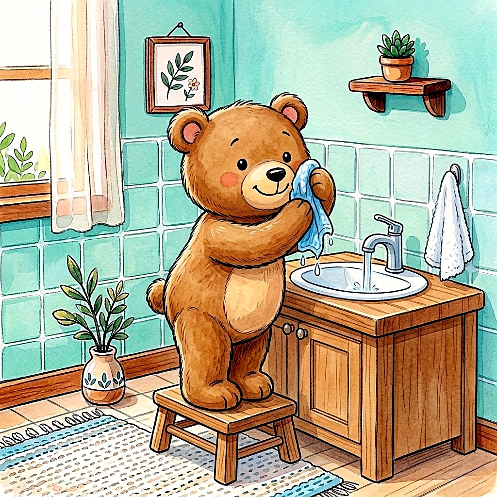 | 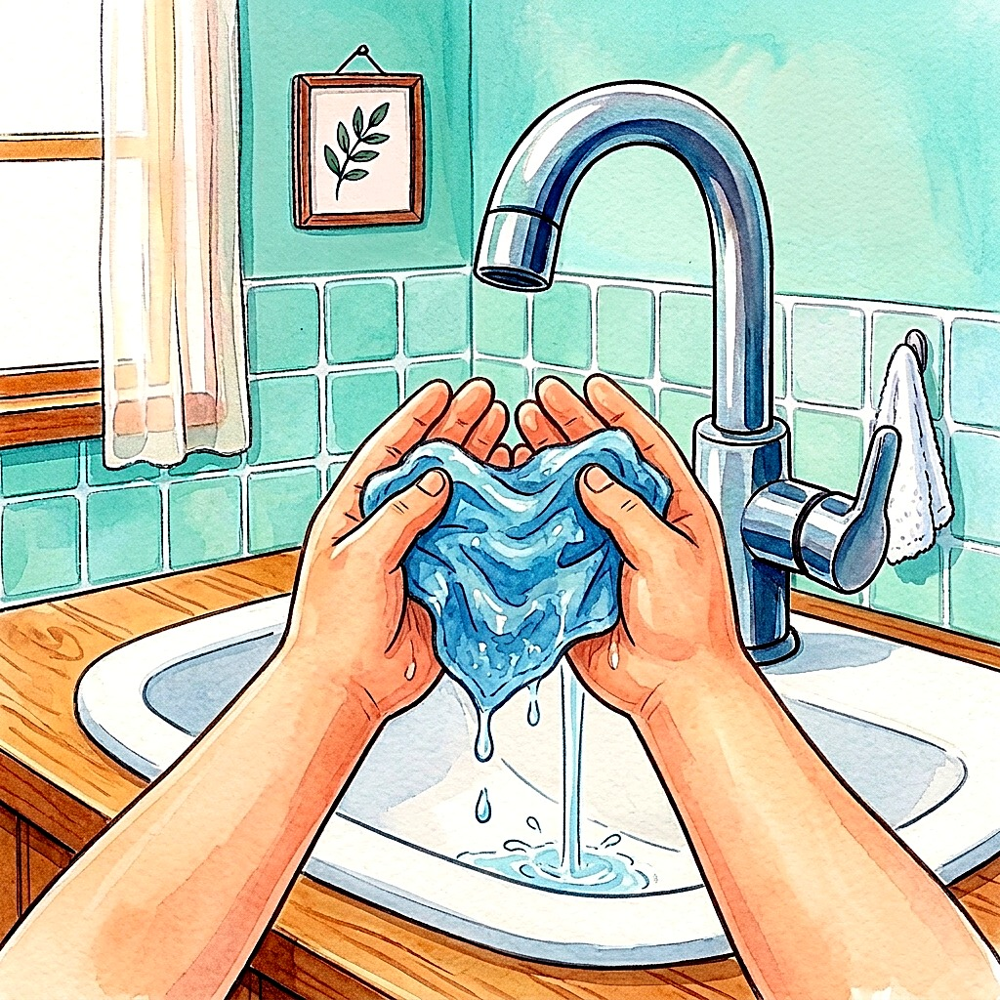 | `wash-face` `wash-face-plain` | Teddy bear on a step stool at the bathroom sink, wiping its face with a blue washcloth | sl: obraz*, umij obraz, umivanje obraza en: wash face, wash your face, face | — |
| — |  | `wash-hands` | Child's hands washing under a tap with soap bubbles | sl: roke, rok, umivanje rok, umij roke, milo en: wash hands, hands, hand washing, handwashing, soap | en-example: MORNING ROUTINE 4 en-example: DINNER 2 sl-primer: JUTRANJA RUTINA 4 sl-primer: VEČERJA 2 |
